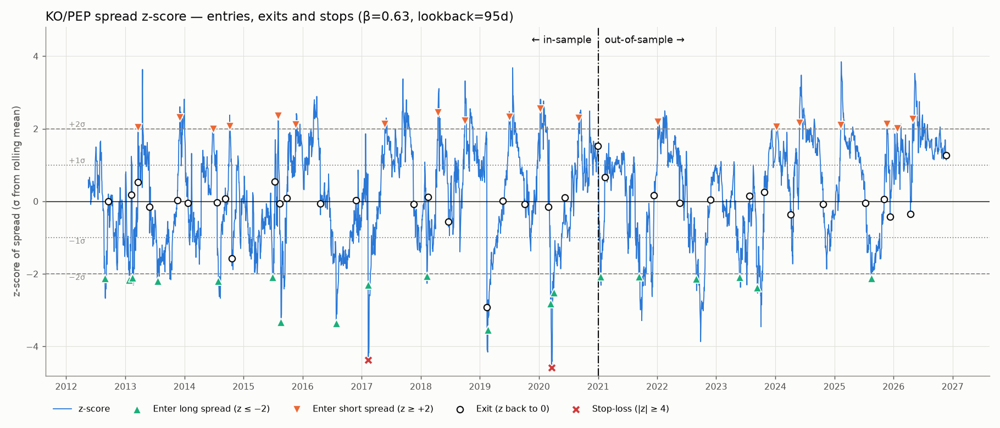
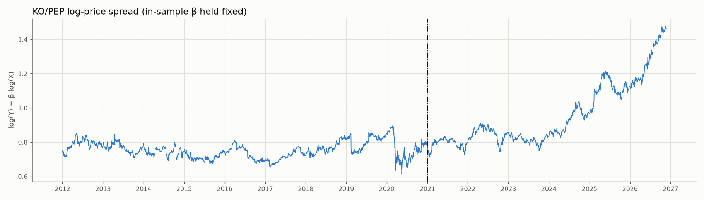
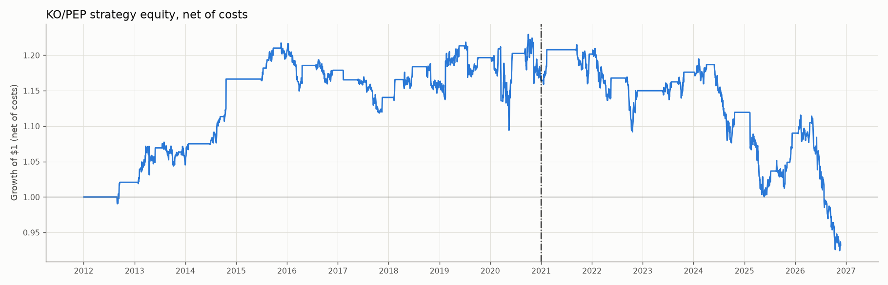
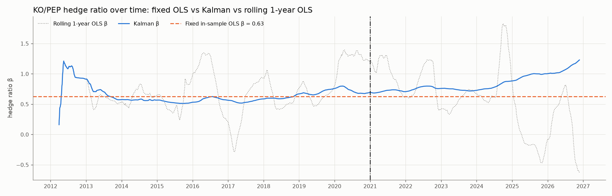
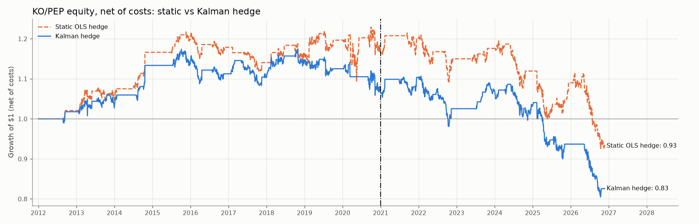
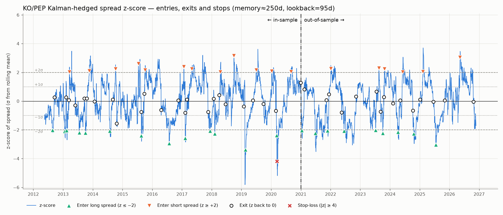
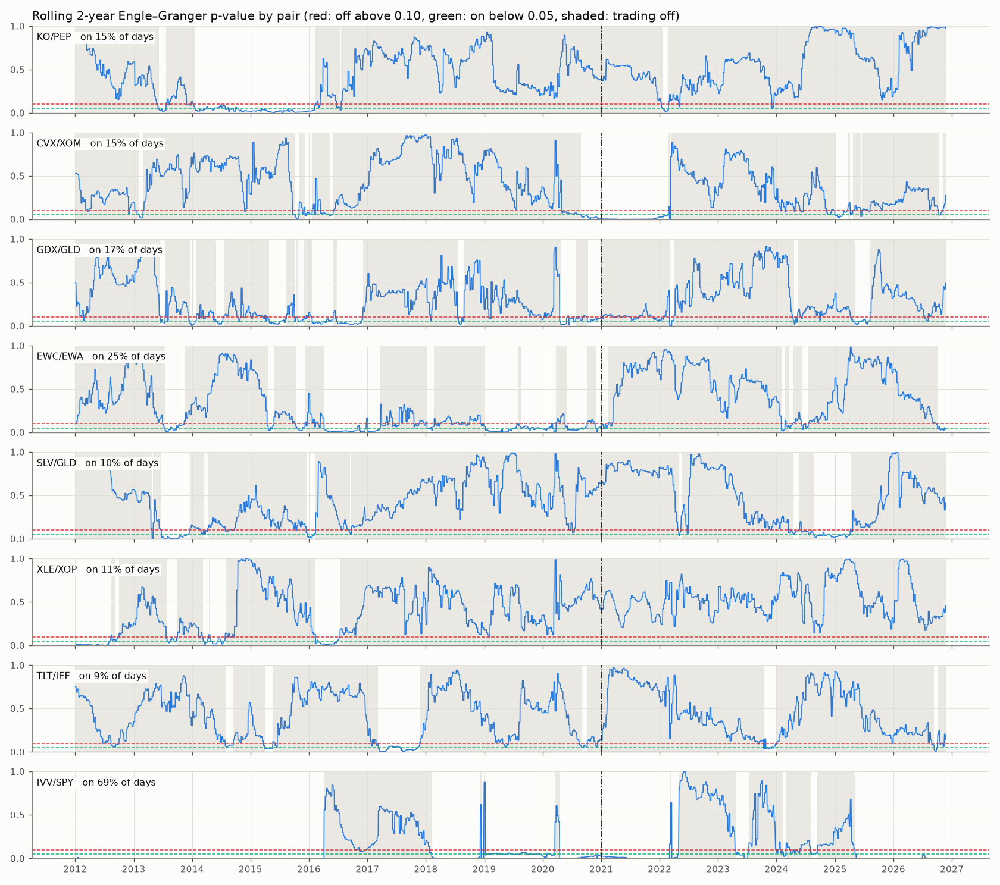
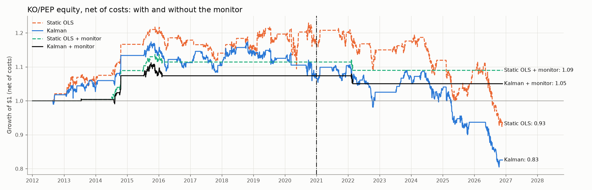
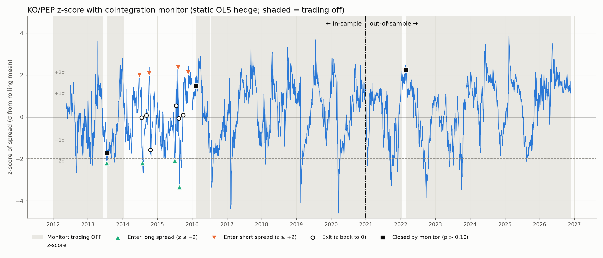
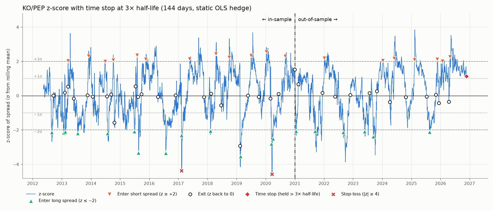

# Pairs Trading Research: Mean Reversion, Properly

A learning project. It tests eight candidate pairs for cointegration, measures
how quickly each spread mean-reverts, and backtests a z-score strategy with
realistic costs and a strict in-sample / out-of-sample split. It then runs
three attempts to fix what went wrong: a dynamic hedge ratio, a cointegration
monitor and a time stop.

## Conclusions

**In one sentence: finding statistical mean reversion in historical data is
easy. Finding mean reversion that still pays after costs on data you haven't
seen is hard, and none of the four refinements I tried changed that.**

### Every experiment at a glance

Out-of-sample (2021 – Nov 2026), averaged over the seven real pairs (IVV/SPY
excluded), net of 5 bps/leg/side costs and 50 bps/yr borrow. Every setting was
fixed before looking at out-of-sample data.

| Step | Variant | IS Sharpe | **OOS Sharpe** | OOS Max DD | OOS time in market | Verdict |
|---|---|---|---|---|---|---|
| 4–5 | Static OLS hedge (baseline) | 0.27 | **−0.09** | −16.4% | 57% | In-sample edge disappears out-of-sample |
| 6 | Kalman dynamic hedge | 0.24 | **+0.01** | −13.6% | 45% | Helps where β really changes (TLT/IEF, GDX/GLD); not KO/PEP |
| 7 | Static + cointegration monitor | 0.08 | **−0.20** | −5.3% | 3.5% | Lower drawdown only from not trading |
| 7 | Kalman + cointegration monitor | −0.01 | **−0.38** | −4.1% | 1.9% | Monitor cancels Kalman's wins |
| 8 | Static + time stop (3× half-life) | 0.28 | **−0.08** | −16.4% | 56% | Almost never fires |
| 8 | Kalman + time stop (3× half-life) | 0.24 | **+0.01** | −13.6% | 45% | Never fires out-of-sample |

The best variant, Kalman, averages a Sharpe of about 0, and its gain over
baseline is within noise. KO/PEP was the pair selected in-sample, and **no**
variant made it profitable out-of-sample.

### What I learned

1. **Cointegration is an empirical regularity, not a law.** KO/PEP passed
   Engle–Granger with p = 0.007 on 2012–2020 and p = 0.994 on 2021–2026. The
   businesses diverged (PepsiCo's snacks vs Coca-Cola's beverages), and no
   statistic computed on the past could have known in advance. A strategy
   built on "this relationship will hold" needs a reason to believe it will.

2. **The out-of-sample split is the most valuable thing in the project.**
   The five pairs with in-sample Sharpes of 0.2–0.7 scored between −0.6 and +0.1 out-of-sample. The
   in-sample *ranking* of pairs didn't predict the out-of-sample ranking
   either. Without the split, every conclusion here would have been wrong.

3. **Use the right test, and know what it can and can't tell you.** A naive
   ADF test on regression residuals overstates significance, and Engle–Granger
   critical values fix that. Short windows have little power: a 2-year
   test rejected even pairs that a 9-year test confirmed. And a stationarity
   test on an adaptive (Kalman) spread is nearly meaningless, because the
   filter makes it stationary by design.

4. **The half-life matters as much as the p-value.** It sets the z-score
   window, predicts how long trades last (the median trade lasted 0.45
   half-lives) and rules out pairs that are too slow to trade (SLV/GLD: 322 days).

5. **Costs decide everything for fast, tight spreads.** IVV/SPY had a Sharpe of +2.1
   before costs and −2.1 after. Slower pairs lose 0.04–0.25 of Sharpe to costs.
   Adaptive methods trade more (Kalman: +13% turnover).

6. **Look-ahead bias is easy to introduce and hard to spot.** The safeguards
   here: a rolling z-score; yesterday's weights earning today's return; a
   hedge ratio, half-life, filter settings and thresholds all fixed
   in-sample; and Kalman and monitor estimates that only ever use past data.

7. **A fix has to match the failure.** KO/PEP's failure was a *trend in the
   spread's level*.
   - A Kalman filter fixes a *changing hedge ratio*, a different problem, so
     it misread the trend as a β change and made KO/PEP worse. It did help
     where β genuinely moves: Treasury durations shift with rates, and
     miners' leverage to gold shifts with their costs.
   - A rolling cointegration test was too weak to detect anything in time.
   - A time stop addresses trades that never end, but KO/PEP's trades did end.
     The rolling z-score drifted back to 0 and booked the loss.

8. **Check every "improvement" for robustness before believing it.** Each
   experiment came with (a) a sweep over its key setting (Kalman memory,
   monitor window, time-stop multiple) and (b) a trade-level test where
   possible. They caught one fluke: CVX/XOM's Kalman gain appeared at only
   1 of 5 memory settings. They also showed that the monitor and the time
   stop had no detectable effect on trade quality (p = 0.74 in both cases).
   A lower drawdown from simply trading less is not risk management.

9. **The rolling z-score is a hidden part of the model.** Its moving mean is
   why the strategy made a little money on pairs that weren't cointegrated
   in-sample (it creates short-term reversion out of any random walk). It is
   also why 77% of losing trades exited "normally" at z = 0, and why a time
   stop has almost nothing left to do. Changing the signal construction
   would probably matter more than any filter added on top.

10. **A negative result, done carefully, is still a result.** The conclusion
    "textbook ±2σ pairs trading on well-known daily pairs doesn't survive
    out-of-sample after costs" is consistent with academic work showing that
    simple pairs-trading returns have declined since the 1990s (e.g. Do &
    Faff, 2010, *Does Simple Pairs Trading Still Work?*). These are among the
    most widely traded pairs in the market.

If I continued, I'd change *what is measured* rather than add more filters on
top. That means walk-forward testing across many OOS windows, a larger
same-sector universe with multiple-testing correction, and a different signal
construction. See "Ideas to explore next".

---

## How to run

```bash
python3 -m venv .venv
.venv/bin/pip install -r requirements.txt
.venv/bin/python run_research.py          # prints all tables, writes ./output/
```

On the first run, prices are downloaded from Yahoo Finance and cached in
`data/prices.csv`. That file isn't committed; delete it to download fresh data.
Fresh data extends past Nov 2026, so the numbers will differ slightly from
those in this README. The committed `output/` folder holds the exact results
described here.

## Project layout

Each module opens with a docstring that teaches the concept it implements.
Read them in this order:

| File | Step | What you learn |
|---|---|---|
| `pairs/data.py` | 1 | Adjusted prices, alignment, why forward-filling is wrong |
| `pairs/cointegration.py` | 2 | Correlation vs cointegration, Engle–Granger, ADF, the critical-value trap |
| `pairs/ou.py` | 3 | Ornstein–Uhlenbeck model, the AR(1) fit, half-life |
| `pairs/kalman.py` | 3b | A hedge ratio that moves: Kalman filter, innovations, and the adapt-speed dilemma |
| `pairs/monitor.py` | 3c | Rolling cointegration test as an on/off switch, hysteresis, and the low-power problem |
| `pairs/backtest.py` | 4 | Rolling z-score, the state machine, stops and the time stop, position sizing, look-ahead, costs |
| `pairs/plotting.py` | 5 | Charts |
| `run_research.py` | — | The pipeline and the in-sample/out-of-sample discipline |

Outputs in `output/`:
- `cointegration_ou_stats.csv`: test statistics and half-lives for every pair
- `backtest_all_pairs.csv`: Sharpe, drawdown, trades, etc. for every pair, both hedge methods, IS and OOS
- `hedge_comparison.csv`: static OLS vs Kalman, side by side
- `zscore_KO_PEP.png`: z-score with ±1/±2 bands, entries, exits, stops, and the IS/OOS line
- `zscore_KO_PEP_kalman.png`: the same for the Kalman-hedged spread
- `beta_KO_PEP.png`: fixed vs Kalman vs rolling-OLS hedge ratio over time
- `equity_KO_PEP.png`, `equity_KO_PEP_compare.png`, `spread_KO_PEP.png`: equity curves and raw spread
- `trades_KO_PEP.csv`, `trades_KO_PEP_kalman.csv`, `cost_sensitivity_KO_PEP.csv`
- `kalman_memory_sensitivity_KO_PEP.csv`, `kalman_memory_grid_oos_all_pairs.csv`: robustness checks
- `monitor_KO_PEP.png`, `monitor_all_pairs.png`: rolling 2-year EG p-value with on/off periods shaded
- `zscore_KO_PEP_monitor.png`, `equity_KO_PEP_monitor.png`, `trades_KO_PEP_monitor.csv`
- `monitor_comparison.csv`: all four variants side by side
- `monitor_trade_attribution.csv`: every un-monitored trade, labelled with the monitor's state at entry
- `monitor_window_grid_oos_all_pairs.csv`: 1-, 2- and 3-year monitor windows (robustness)
- `time_stop_comparison.csv`: static / Kalman, with and without the time stop, per pair
- `time_stop_counterfactual.csv`: each time-stopped trade vs the same trade with no time stop
- `time_stop_multiplier_grid.csv`: 2×, 3×, 4×, 5× half-life (robustness)
- `zscore_KO_PEP_timestop.png`, `equity_KO_PEP_timestop.png`, `trades_KO_PEP_timestop.csv`
- `run_log.txt`: full console output of the last run

## Setup

| Choice | Value | Why |
|---|---|---|
| Data | Yahoo daily adjusted closes, Jan 2012 – Nov 2026 (2010–2011 downloaded only to warm up the monitor) | Adjusted prices, so dividends don't create fake spread jumps |
| In-sample | 2012 – 2020 (9 years) | Every decision is made here |
| Out-of-sample | 2021 – Nov 2026 (~6 years) | Only measured, never tuned on |
| Spread | `log(Y) − β·log(X)`, β from in-sample OLS, **held fixed** OOS | Re-estimating β with OOS data would leak the future |
| Z-score | Rolling mean/std, window ≈ 2 × half-life, clipped to [20, 120] days | Rolling, so the signal only uses past data |
| Rules | Enter at \|z\| ≥ 2, exit at z = 0, stop at \|z\| ≥ 4 | Textbook defaults. **Deliberately not optimised** |
| Execution | Signal at close t, position earns return from t to t+1 | Avoids same-bar look-ahead |
| Costs | 5 bps per leg per side, plus 50 bps/yr borrow on the short leg | Realistic for liquid US names in a small account |
| Sizing | $1 gross exposure, dollar weights 1/(1+β) and β/(1+β) | Unlevered. Returns are per dollar deployed |
| Dynamic hedge (Step 6) | Kalman filter on (α, β), memory ≈ 250 days, R from in-sample OLS residuals; rebalanced daily | Fixed in advance; other memories shown only as a robustness check |
| Cointegration monitor (Step 7) | EG test on trailing 504 days, re-run weekly; trading OFF when p > 0.10, back ON when p < 0.05; open trades closed at switch-off | Specified up front; 1- and 3-year windows shown only as a robustness check |
| Time stop (Step 8) | Close any trade open longer than ⌈3 × in-sample OU half-life⌉ trading days; no re-entry until \|z\| < 2 | Specified up front; 2×, 4×, 5× shown only as a robustness check |
| Pair selection | EG p < 0.05 **and** half-life between 2 and 60 days, then highest **in-sample** net Sharpe | Selection uses only in-sample information |

## Results

### Step 2–3: Cointegration and half-life (in-sample, 2012–2020)

| Pair | β | ADF p (Y) | ADF p (X) | Naive ADF p | **EG p** | Half-life (days) | EG p OOS *(hindsight)* |
|---|---|---|---|---|---|---|---|
| KO/PEP | 0.63 | 0.69 | 0.75 | 0.001 | **0.007** | 47.7 | 0.994 |
| EWC/EWA | 0.79 | 0.13 | 0.15 | 0.000 | **0.001** | 30.8 | 0.039 |
| GDX/GLD | 2.05 | 0.20 | 0.73 | 0.136 | 0.316 | 59.9 | 0.290 |
| XLE/XOP | 0.35 | 0.32 | 0.79 | 0.066 | 0.182 | 117 | 0.100 |
| TLT/IEF | 1.87 | 0.94 | 0.97 | 0.069 | 0.189 | 51.0 | 0.986 |
| CVX/XOM | 0.35 | 0.06 | 0.56 | 0.197 | 0.411 | 139 | 0.202 |
| SLV/GLD | 1.27 | 0.19 | 0.73 | 0.369 | 0.619 | 322 | 0.275 |
| IVV/SPY | 1.00 | 0.89 | 0.89 | 0.320 | 0.566 | 8.2 | 0.091 |

How to read the table:
- **ADF p on each leg is large** (> 0.05 in every case). Each price series
  behaves like a random walk, which is what we expect.
- **EG p is the real test.** Only **KO/PEP** and **EWC/EWA** are cointegrated
  at 5% in-sample.
- **The naive ADF p is always smaller than the EG p.** Look at KO/PEP: 0.001
  naive vs 0.007 Engle–Granger. Running a plain ADF on regression residuals
  makes every pair look more significant than it is.
- **Half-life matters as much as the p-value.** SLV/GLD has a 322-day
  half-life, so a trade would take most of a year to close half its gap.
- The OOS columns are **hindsight diagnostics**. They explain the results
  afterwards and played no part in selection.

### Step 4: Backtest, all pairs (net of costs)

| Pair | Period | **Sharpe** | Gross Sharpe | CAGR | **Max DD** | **# Trades** | Win rate |
|---|---|---|---|---|---|---|---|
| KO/PEP | IS | 0.33 | 0.40 | 1.7% | −10.2% | 25 | 68% |
| | OOS | **−0.58** | −0.52 | −3.7% | −23.9% | 13 | 54% |
| EWC/EWA | IS | 0.21 | 0.32 | 0.8% | −10.9% | 35 | 71% |
| | OOS | 0.03 | 0.18 | 0.0% | −11.2% | 25 | 72% |
| GDX/GLD | IS | 0.67 | 0.74 | 3.6% | −10.8% | 24 | 83% |
| | OOS | 0.04 | 0.12 | 0.1% | −15.5% | 16 | 75% |
| CVX/XOM | IS | 0.56 | 0.60 | 4.8% | −22.1% | 21 | 71% |
| | OOS | 0.12 | 0.16 | 0.7% | −24.4% | 11 | 64% |
| XLE/XOP | IS | 0.36 | 0.42 | 2.0% | −9.3% | 20 | 65% |
| | OOS | −0.07 | −0.03 | −1.0% | −24.5% | 13 | 54% |
| SLV/GLD | IS | −0.15 | −0.08 | −0.9% | −21.0% | 18 | 61% |
| | OOS | −0.10 | −0.04 | −0.7% | −11.2% | 12 | 42% |
| TLT/IEF | IS | −0.11 | 0.18 | −0.2% | −5.3% | 22 | 64% |
| | OOS | −0.04 | 0.21 | −0.1% | −4.4% | 15 | 67% |
| IVV/SPY | IS | **−2.07** | **+2.11** | −0.6% | −5.3% | 102 | 8% |
| | OOS | −2.99 | +1.19 | −0.9% | −5.3% | 69 | 0% |

### Step 5: The selected pair, KO/PEP

KO/PEP passed both filters and had the higher in-sample Sharpe of the two
eligible pairs. Hedge ratio β = 0.63, OU half-life = 47.7 days, z lookback = 95 days.





| | In-sample (2012–2020) | Out-of-sample (2021–2026) |
|---|---|---|
| Sharpe (net) | **0.33** | **−0.58** |
| Max drawdown | −10.2% | −23.9% |
| Number of trades | 25 | 13 |
| Win rate | 68% | 54% |
| Average hold | 42 days | 65 days |

Cost sensitivity (net Sharpe):

| Cost per leg per side | 0 bps | 2 | 5 | 10 | 20 |
|---|---|---|---|---|---|
| Static, IS | 0.37 | 0.36 | 0.33 | 0.28 | 0.18 |
| Static, OOS | −0.55 | −0.56 | −0.58 | −0.62 | −0.70 |
| Kalman, IS | 0.22 | 0.20 | 0.17 | 0.11 | −0.01 |
| Kalman, OOS | −0.69 | −0.71 | −0.74 | −0.79 | −0.88 |

### Step 6: Fixed OLS hedge vs Kalman-filter dynamic hedge

The first run's diagnosis was that KO/PEP failed because its relationship
drifted while β stayed frozen at its 2012–2020 value. The standard fix is to let β
adapt, and `pairs/kalman.py` does that with a Kalman filter. It treats α and β
as slowly wandering hidden states, re-estimates them each day from past data
only, and uses the filter's one-step-ahead prediction error as the trading spread.

**Only the hedge ratio changes.** The pair direction, z-score lookback,
±2/0/±4 rules, 5 bps costs, 50 bps borrow and the 2021 split are all identical.
The filter's settings come from in-sample data. Its noise level R is the
in-sample OLS residual variance, and its memory is ≈ 250 trading days, chosen
in advance as several times the spreads' 30–60 day half-lives. Positions are
rebalanced daily to the current β, and that extra turnover is charged at the
same cost.

#### Comparison table (net of costs)

| Pair | Static IS Sharpe | Kalman IS Sharpe | **Static OOS Sharpe** | **Kalman OOS Sharpe** | Static OOS Max DD | Kalman OOS Max DD | OOS trades (static / Kalman) | Kalman beats static OOS at *n* of 5 memory settings |
|---|---|---|---|---|---|---|---|---|
| KO/PEP | 0.33 | 0.17 | −0.58 | **−0.74** | −23.9% | −27.3% | 13 / 15 | 1 |
| EWC/EWA | 0.21 | 0.21 | 0.03 | −0.04 | −11.2% | −10.1% | 25 / 26 | 1 |
| GDX/GLD | 0.67 | 0.34 | 0.04 | **0.46** | −15.5% | −7.4% | 16 / 16 | **4** |
| CVX/XOM | 0.56 | 0.63 | 0.12 | 0.27 | −24.4% | −8.9% | 11 / 14 | 1 |
| XLE/XOP | 0.36 | 0.21 | −0.07 | 0.06 | −24.5% | −10.1% | 13 / 14 | 2 |
| TLT/IEF | −0.11 | 0.12 | −0.04 | **0.43** | −4.4% | −2.6% | 15 / 20 | **5** |
| SLV/GLD | −0.15 | −0.03 | −0.10 | −0.39 | −11.2% | −28.6% | 12 / 13 | 0 |
| IVV/SPY | −2.07 | −2.02 | −2.99 | −3.46 | −5.3% | −3.9% | 69 / 57 | 0 |
| **Average (excl. IVV/SPY)** | 0.27 | 0.24 | **−0.09** | **0.01** | −16.4% | −13.6% | | |

The last column re-runs the OOS backtest with filter memories of 60, 125, 250,
500 and 1000 days (`kalman_memory_grid_oos_all_pairs.csv`). It answers the
question *"is the improvement real, or did I get lucky with 250?"*. It is a
robustness check only. Picking whichever memory had the best OOS result would
be overfitting to the OOS period.





#### What the comparison shows

1. **Kalman did not rescue KO/PEP. It made it worse** (OOS Sharpe −0.58 → −0.74).
   The β chart shows why. From 2024 the filter pushes β from ~0.75 up to 1.23,
   about twice the PEP hedge the fixed model (β = 0.63) holds against each dollar of KO. KO/PEP's
   problem was never "the right mix of the two stocks changed". It was that KO
   steadily *out-performed* PEP, a trend in the spread's *level*. A filter
   with a one-year memory can't absorb a trend that fast, and it partly
   mistakes the level drift for a change in β, so it hedges with the wrong
   amount. Longer memories hurt less (Sharpe −0.51 at 1000 days), but every
   setting lost money. **A dynamic hedge ratio fixes a changing hedge ratio. It
   does not fix a broken relationship.**

2. **It helped where β really does change for an economic reason.**
   - **TLT/IEF** improved at every memory setting (OOS Sharpe −0.04 → 0.43
     at 250 days). The right ratio between a 20+-year and a 7–10-year Treasury
     fund is roughly the ratio of their durations, and that ratio moves with the level
     of interest rates. 2022's rate shock moved it a lot, so a frozen β was
     wrong by construction.
   - **GDX/GLD** improved at 4 of 5 settings (0.04 → 0.46, with drawdown halved).
     Gold miners' sensitivity to gold depends on their profit margins, which
     shifted with energy and labour costs after 2021.

   These are the cases where a Kalman filter is the right tool.

3. **Some improvements were luck.** CVX/XOM improved at the pre-chosen 250-day
   memory (0.12 → 0.27) but at only 1 of 5 settings. At 60, 125, 500 and 1000 it
   was *worse* than static. Without the robustness grid this would look like a
   win.

4. **Kalman makes every spread look stationary.** The Kalman spreads of all
   seven non-trivial pairs reject a unit root in-sample (ADF p ≤ 0.013), including
   the five that failed Engle–Granger. That's not evidence of a relationship;
   it's what an adaptive filter does. It soaks up drift by design. **So a
   stationarity test on a Kalman spread is not a substitute for testing
   cointegration first.** It's also why the selection step still uses
   Engle–Granger on the static fit.

5. **The aggregate gain is small and within noise.** Averaged over the seven
   real pairs, OOS Sharpe went from −0.09 to +0.01, and OOS max drawdown
   improved from −16.4% to −13.6%. The drawdown improvement is the most
   consistent effect: when the static β is wrong, the position carries an
   unintended directional bet, and adapting β removes much of it. But a Sharpe
   of ~0 is still not a strategy. Using the same in-sample selection rule with
   the Kalman Sharpe would have picked EWC/EWA, which made −0.04 OOS.

6. **Adaptive costs more.** Daily rebalancing to a moving β raised annual
   turnover by ~13% (5.1× → 5.8× capital per year on average). KO/PEP's Kalman
   version loses all of its in-sample edge at 20 bps, where the static one keeps
   a Sharpe of 0.18.


### Step 7: Rolling cointegration monitor (both hedge methods)

The Kalman experiment suggested that the real problem is noticing when a pair
**stops being a pair**. `pairs/monitor.py` re-runs the Engle–Granger test every
week on the trailing **2 years** (504 trading days) of prices, using only data
up to that day. That gives a p-value for each date. It works as a switch with
hysteresis:

* **OFF** when p rises above **0.10**. No new trades, and any open trade is
  closed that day.
* **ON** again only when p falls back below **0.05**.
* It starts OFF, so trading requires positive evidence.

The two thresholds create a dead band, so a p-value hovering near 0.05 doesn't
flip the switch every week. One monitor serves both hedge methods, because it
tests the price relationship and re-fits its own β inside each window.
Everything else (split, rules, lookback, costs) is unchanged, so the four
variants differ only in the hedge and the switch.



#### How often was trading allowed?

| Pair | Full-period EG p (IS) | Monitor ON, IS | Monitor ON, OOS | Switch-offs IS / OOS |
|---|---|---|---|---|
| KO/PEP | 0.007 | 25% | **2%** | 3 / 1 |
| CVX/XOM | 0.411 | 7% | 26% | 4 / 6 |
| GDX/GLD | 0.316 | 23% | 7% | 12 / 3 |
| EWC/EWA | 0.001 | 36% | 8% | 10 / 4 |
| SLV/GLD | 0.619 | 8% | 13% | 5 / 3 |
| XLE/XOP | 0.182 | 18% | **0%** | 6 / 0 |
| TLT/IEF | 0.189 | 12% | 4% | 4 / 3 |
| IVV/SPY | 0.566 | 78% | 54% | 4 / 5 |

This table is the key to everything below. **A 2-year Engle–Granger test
almost never says "cointegrated".** Even KO/PEP and EWC/EWA, which pass the
9-year in-sample test easily (p = 0.007 and 0.001), pass the 2-year test on
only 25% and 36% of in-sample days. A spread with a 30–50 day half-life only
completes a handful of full cycles in 504 days, which is too few for the test
to reach a confident conclusion. This is the *low power* problem: the test
often fails to detect a relationship that is really there.

#### Comparison: all four variants (net of costs)

| Pair | Static OOS Sharpe | Static **+ monitor** | Kalman OOS Sharpe | Kalman **+ monitor** | Static OOS Max DD → + monitor | OOS trades: static / +mon |
|---|---|---|---|---|---|---|
| KO/PEP | −0.58 | **−0.32** | −0.74 | −0.34 | −23.9% → **−2.7%** | 13 / 1 |
| CVX/XOM | 0.12 | −0.63 | 0.27 | −0.64 | −24.4% → −22.4% | 11 / 6 |
| GDX/GLD | 0.04 | 0.41 | **0.46** | −0.56 | −15.5% → −2.2% | 16 / 4 |
| EWC/EWA | 0.03 | 0.07 | −0.04 | 0.09 | −11.2% → −1.4% | 25 / 3 |
| SLV/GLD | −0.10 | −0.57 | −0.39 | −0.58 | −11.2% → −7.8% | 12 / 3 |
| XLE/XOP | −0.07 | 0.00 (no trades) | 0.06 | 0.00 (no trades) | −24.5% → 0% | 13 / 0 |
| TLT/IEF | −0.04 | −0.33 | **0.43** | −0.65 | −4.4% → −0.6% | 15 / 1 |
| IVV/SPY | −2.99 | −2.72 | −3.46 | −2.58 | −5.3% → −2.6% | 69 / 36 |

Averages over the seven real pairs (excluding IVV/SPY):

| Variant | IS Sharpe | **OOS Sharpe** | OOS Max DD | OOS trades | OOS time in market |
|---|---|---|---|---|---|
| Static OLS | 0.27 | −0.09 | −16.4% | 15.0 | 57% |
| Kalman | 0.24 | **+0.01** | −13.6% | 16.9 | 45% |
| Static OLS + monitor | 0.08 | −0.20 | −5.3% | 2.6 | **3.5%** |
| Kalman + monitor | −0.01 | **−0.38** | −4.1% | 1.9 | **1.9%** |




#### Did the monitor actually pick better trades?

Sharpe ratios built from 1–3 trades are mostly noise, so I ran a more direct
test. I took **every trade** from the unmonitored backtests (571 trades: 7 pairs,
both hedges, IS and OOS) and split them by whether the monitor was ON or OFF on
the entry date. If the monitor knows anything, ON trades should do better.

| Monitor at entry | Trades | Mean net return | Win rate | Worst trade |
|---|---|---|---|---|
| ON | 100 | +0.36% | 62% | −18.0% |
| OFF | 471 | +0.25% | 65% | −15.6% |

The difference is +0.11 percentage points, with t = 0.33 and **p = 0.74**. In
plain terms: **no evidence that the monitor can tell good trades from bad
ones.** Out-of-sample it looks slightly worse: ON trades averaged −0.63%
(static, 11 trades) vs −0.13% for OFF (94 trades), and the single worst trade
in the whole set was entered while the monitor said ON.

**Robustness across window lengths** (`monitor_window_grid_oos_all_pairs.csv`,
mean OOS Sharpe over 7 pairs):

| Window | Static + monitor | Kalman + monitor |
|---|---|---|
| none (baseline) | −0.09 | +0.01 |
| 1 year (252 d) | +0.08 | −0.28 |
| **2 years (504 d), as specified** | −0.20 | −0.38 |
| 3 years (756 d) | −0.23 | −0.11 |

No window improves both hedge methods, and the effect changes sign with the
window. That is the signature of noise rather than an edge.

#### What the monitor experiment shows

1. **It kept the strategy out of the KO/PEP disaster, but not because it
   detected the break.** KO/PEP's OOS drawdown shrank from −23.9% to −2.7%,
   and the full-history equity ends at 1.09 instead of 0.93. But look at the
   p-value chart. The monitor rated KO/PEP "not cointegrated" for almost all
   of mid-2016 to 2020 as well. That wasn't a bad call: the unmonitored
   strategy roughly broke even there (12 trades, 50% wins, −1.8%). But all
   of KO/PEP's in-sample profit came from 2012–2015, and the monitor was OFF
   for about half of that period too (ON 52% of days). It was already OFF on the first OOS day
   (p ≈ 0.4 after the COVID shock) and switched ON for just a few weeks in
   early 2022. It didn't see 2024 coming; it rarely trusted the pair at all.

2. **Most of the drawdown "improvement" comes from not being in the market.**
   Out-of-sample the monitored strategies were invested 2–4% of the time,
   versus 45–57% without the monitor. A strategy that never trades has zero
   drawdown, and that isn't risk management. The fair comparison is the trade
   attribution test above, and it shows nothing.

3. **It switched off exactly the pairs where the Kalman filter was working.**
   TLT/IEF went from +0.43 to −0.65, and GDX/GLD from +0.46 to −0.56. This
   isn't a coincidence. The monitor asks "is there one fixed β that has worked for
   the last two years?" The Kalman filter's whole premise is that there
   isn't. Those pairs fail the monitor *because* their β drifts, which is
   exactly why Kalman helped there. Combining them makes each undo the
   other. A monitor that matched the Kalman approach would test the Kalman
   spread, and Step 6 showed that the Kalman spread looks stationary
   almost by construction. **Deciding when a relationship is "broken" depends
   on your model of the relationship. There's no model-free answer.**

4. **Hysteresis did its job mechanically.** It produced 0–6 switch-offs per pair
   out-of-sample (3–12 in-sample) instead of weekly flapping. But a stable switch is only useful
   if the signal driving it is informative, and this one wasn't.

5. **Selection already made a stricter version of this decision.** A full
   9-year test (p = 0.007) is far more powerful than any 2-year window. Asking
   a weaker test to overrule a stronger one, week by week, mostly adds noise.
   The useful version of this idea needs either more data per test or a
   faster-reacting signal (see "Ideas to explore next").


### Step 8: Time stop at 3× the in-sample half-life (static and Kalman)

The OU half-life says how long a mispricing *should* take to fade. A trade
still open after three half-lives is behaving abnormally. The time stop closes
it, whatever z is doing, and blocks re-entry until |z| drops back below 2 (as
the stop-loss does). It is a behavioural kill switch: it reacts within a few
months to what the *trade* does, where the Step 7 monitor needed two years of data. Same
split, rules and costs; no monitor.

| Pair | Half-life (d) | Time stop (d) | Static OOS Sharpe → + time stop | Kalman OOS Sharpe → + time stop | Time stops fired (static IS / OOS; Kalman IS / OOS) |
|---|---|---|---|---|---|
| KO/PEP | 47.7 | 144 | −0.58 → −0.57 | −0.74 → −0.74 | 0 / 1; 0 / 0 |
| EWC/EWA | 30.8 | 93 | 0.03 → 0.06 | −0.04 → −0.04 | 1 / 3; 0 / 0 |
| GDX/GLD | 59.9 | 180 | 0.04 → −0.01 | 0.46 → 0.46 | 0 / 1; 0 / 0 |
| TLT/IEF | 51.0 | 153 | −0.04 → 0.00 | 0.43 → 0.43 | 3 / 1; 1 / 0 |
| CVX/XOM | 138.7 | 417 | 0.12 → 0.12 | 0.27 → 0.27 | 0 / 0; 0 / 0 |
| XLE/XOP | 117.4 | 353 | −0.07 → −0.07 | 0.06 → 0.06 | 0 / 0; 0 / 0 |
| SLV/GLD | 321.7 | 965 | −0.10 → −0.10 | −0.39 → −0.39 | 0 / 0; 0 / 0 |
| **Mean (7 pairs)** | | | **−0.086 → −0.081** | **+0.007 → +0.007** | 11 trades in total |

Robustness (mean OOS Sharpe, 7 pairs, `time_stop_multiplier_grid.csv`):

| Time stop | none | 2× | **3×** | 4× | 5× |
|---|---|---|---|---|---|
| Static | −0.086 | −0.068 | −0.081 | −0.079 | −0.100 |
| Kalman | +0.007 | −0.001 | +0.007 | +0.007 | +0.007 |

Counterfactual (`time_stop_counterfactual.csv`): each time-stopped trade has a
twin in the baseline run with the same entry date. Across all 11, the time
stop improved the trade's return by +0.12 percentage points on average
(t = 0.34, **p = 0.74**). The six static OOS ones averaged −6.53% when
stopped vs −6.51% when left alone. KO/PEP's worst trade (−15.6%, 145 days)
was stopped on day 144 at −15.3%. The loss had already happened.

#### Why the time stop does almost nothing

Of 571 baseline trades (7 pairs, both hedges, IS and OOS), the **median trade
lasted 0.45 half-lives**. 90% were done within 1.69 half-lives, and only
**1.9%** lasted longer than 3. Long, stale trades are rare in this strategy.
The reason is the rolling z-score. Its mean is computed over ~2 half-lives, so
if the spread stays put, the mean catches up with it, and z drifts back to 0
within about one window even if nothing reverted. **The z = 0 exit already acts
as a built-in time stop.** It doesn't stop losses, though: of the 202 losing trades,
**155 (77%) exited "normally" at z ≈ 0**, 35 hit the stop-loss and 12 were open
at period end. The losses don't come from trades that never end. They come
from trades that end at a loss once the rolling mean has caught up with a
spread that moved against us.

This corrects an expectation I wrote after Step 7: that KO/PEP's worst trades
"ran far past their expected duration". They ran 100–145 days, which is
2.1–3.0 half-lives: long, but mostly inside a 3× limit, and their losses built
up early in the trade. A time stop limits how *long* you hold a trade; KO/PEP's
problem was how *much* the trades lost.



---

## What worked, what didn't, and why

*This section covers the original strategy (Steps 2–5). The Conclusions at the
top cover all experiments.*

### What worked

1. **The statistical tooling.** Engle–Granger correctly separated the two
   in-sample cointegrated pairs from the rest. The OU half-life turned a vague
   "it mean-reverts" into a number that set the z-score lookback and predicted
   holding periods well (the IS average hold of 42 days vs a 48-day half-life).
2. **The in-sample mechanics.** On KO/PEP 2012–2020 the strategy did what the
   theory says it should. It entered at ±2σ, exited near 0, and won 68% of trades.
3. **EWC/EWA held up best structurally.** It is the only pair still cointegrated
   out-of-sample (EG p = 0.039), with a similar half-life (31 → 37 days) and the
   same 70%+ win rate. It also shows the gap between "real" and "tradeable":
   its gross OOS Sharpe was 0.18, and costs and borrow took almost all of it.
4. **The process.** Fixed rules chosen before looking at OOS data, in-sample
   parameters held fixed, trading on the next bar, and realistic costs. Each of
   these made the results look worse, and each made them closer to what a real
   account would have earned.

### What didn't work

1. **KO/PEP stopped being cointegrated.** OOS EG p = 0.994. The spread chart
   shows why: from 2024 KO steadily outperformed PEP. PepsiCo's snacks business
   (Frito-Lay) and its growth problems separated it from Coca-Cola's pure
   beverage model. A fixed β from 2012–2020 had no way to know this. The
   strategy kept shorting the spread as it trended upward. Every "+2σ" was a
   new normal, not an extreme. The last trade lost 15.6% over 145 days.
   **Cointegration is an empirical regularity, not a law. It breaks when the
   underlying businesses diverge.**

2. **Selecting by in-sample performance picked the pair that then failed.**
   The in-sample ranking (GDX/GLD 0.67, CVX/XOM 0.56, KO/PEP 0.33) had almost
   no relationship with the out-of-sample ranking. This is the general lesson
   about backtest overfitting: with eight candidates, the in-sample winner is
   partly the luckiest pair.

3. **Several pairs made money in-sample without being cointegrated.** GDX/GLD
   and CVX/XOM had the best IS Sharpes but failed the EG test. The *rolling*
   z-score creates short-term mean reversion even in a random walk, because the
   rolling mean follows the price. That is not a real edge, and it faded OOS.
   It also explains why some KO/PEP trades exited at z ≈ 0 with a *loss*: the
   rolling mean moved toward the spread instead of the spread returning to the mean.

4. **Costs don't matter much for slow pairs, but they decide fast ones.**
   IVV/SPY (two S&P 500 trackers) is the clearest example: **gross Sharpe
   +2.1, net Sharpe −2.1.** The spread reverts in days, but each move is a
   fraction of a basis point, smaller than the 20 bps round-trip cost. TLT/IEF
   shows the same thing more mildly: positive gross, negative net. Real
   arbitrageurs trade such pairs at sub-basis-point costs, intraday. Daily
   retail trading can't. (IVV/SPY also *fails* EG in-sample despite tracking
   the same index. Small differences in dividend handling and fund structure
   add a slowly wandering component to an otherwise flat spread, and the test
   picks that up correctly.)

5. **The stop-loss helped in normal markets and hurt in March 2020.**
   During the COVID crash KO/PEP went from −2.8σ to −4.6σ in four days and
   stopped out at −6.1%. The next entry recovered +5.9% as the spread
   normalised. Stops protect you against structural breaks like KO/PEP in 2024,
   but they also sell at the worst moment in a liquidity shock, and you can't
   know in advance which of the two you're in.

6. **Drawdowns OOS were roughly double the IS drawdowns** on most pairs. In-sample
   drawdown is an optimistic lower bound on future pain.

### Why, in one paragraph

Mean reversion in a spread is only as durable as the economic link that causes
it. A test on nine years of data tells you the link *held*, not that it *will
hold*. Pairs trading earns small amounts on most trades and occasionally loses
a lot when the relationship breaks: a high win rate with a fat left tail. With
daily data, ±2σ textbook rules, and realistic costs, the remaining edge on
well-known pairs like KO/PEP is small, because many other traders have been
trading these same pairs for decades.

## Ideas to explore next (in roughly the order I'd try them)

1. ~~**Rolling or Kalman-filter hedge ratio.**~~ Done (Step 6). It helped where β
   genuinely varies (TLT/IEF, GDX/GLD) and did not fix KO/PEP. Next variants
   to try: trade the raw Kalman innovation scaled by its own variance
   (z = e/√S, as in Chan's *Algorithmic Trading*), or keep β fixed for the
   life of each trade to cut rebalancing costs.
2. ~~**Rolling cointegration monitor.**~~ Done (Step 7). As an on/off switch
   it mostly kept the strategy out of the market and showed no ability to
   pick trades. Better ways to detect a breakdown are more promising:
   - **Behavioural kill switches** that react to what the trade is doing, not
     to a test statistic. The time stop (Step 8) was tried and did almost
     nothing. A loss-based trade stop, or a rolling OU half-life that blows up,
     are untested.
   - **Continuous sizing.** Scale position size down smoothly as p rises,
     instead of a binary switch.
   - **A higher-power test.** For example Johansen, or EG on a longer window
     combined with a structural-break test.
3. **Walk-forward analysis.** Instead of one split, re-fit every year on the
   previous N years and trade the next one. This gives many OOS periods and a
   much better estimate of real performance.
4. **Johansen test.** A multivariate cointegration test that handles baskets
   (e.g. XOM + CVX + XLE) and doesn't depend on which leg is Y.
5. ~~**Time stop.**~~ Done (Step 8). It rarely fires, because the rolling
   z-score already closes trades within about one window. The higher-value
   experiment is the **signal construction** itself: compare a rolling z-score
   with one anchored to the in-sample OU mean μ and σ (no chasing), and with
   Kalman z = e/√S.
6. **Risk-free rate in Sharpe.** These Sharpes assume 0% cash. In 2023–2025
   T-bills paid ~5%, so the true excess-return Sharpe OOS is even lower.
7. **Larger universe, with care.** Screening hundreds of same-sector pairs will
   find more candidates, but correct for multiple testing (e.g. Bonferroni or
   the false discovery rate). Otherwise you will mostly find noise.

## Caveats

- Yahoo adjusted prices are good enough for research but not for production:
  history can be revised, and adjustment methods differ slightly between sources.
- Fills at the closing price with a flat bps cost are an approximation. Real
  closing-auction fills, partial fills and borrow availability vary.
- Constant dollar weights imply small daily rebalancing that we don't charge
  for. Fixed share counts would remove this, and the effect is small.
- Educational code, not investment advice.
